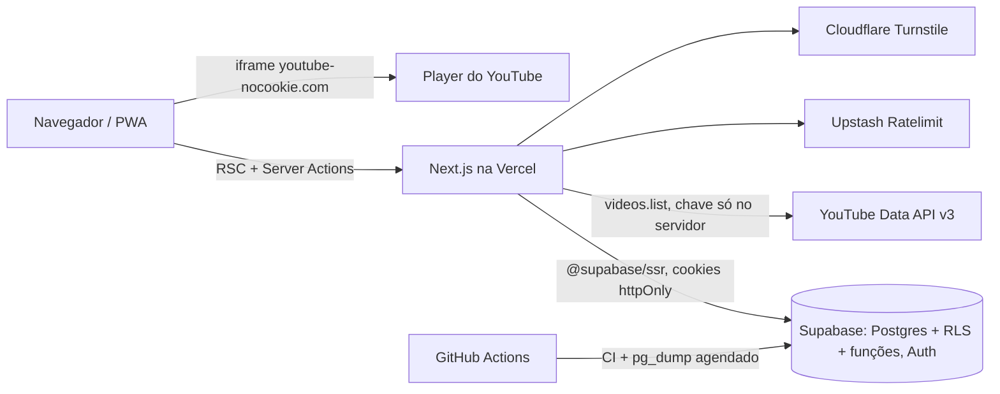

# ARCHITECTURE — EnglishFlix

Status: Fase 0 (fundação). Atualização: 27/11/2026. Marcação: **implementado** (existe e foi verificado) ou **planejado** (fase indicada).

Decisões registradas em [`adr/`](adr/). Fonte da especificação: [PROMPT_MESTRE.md](PROMPT_MESTRE.md) §2, §5, §6 e §8.

## Visão geral



- **Regra de negócio fica no Postgres:** funções `SECURITY DEFINER` com `search_path` fixo + RLS em todas as tabelas. O Next.js orquestra, valida com Zod e renderiza.
- **Sem servidor separado:** Server Actions e Route Handlers fazem o papel de API.
- **Vídeo não passa pelo servidor:** o navegador toca o player oficial do YouTube; o servidor só consulta metadados.

## Stack e decisões

| Camada | Tecnologia | Motivo | Limitação | Status |
| --- | --- | --- | --- | --- |
| Framework | Next.js (App Router) + TypeScript estrito | Server Components por padrão, pouco JS no cliente | Versão nova: ler `node_modules/next/dist/docs` | Implementado (Fase 0) |
| Estilo | Tailwind CSS + shadcn/ui | Tokens centralizados em `app/globals.css` | — | Implementado (Fase 0) |
| Banco e Auth | Supabase (Postgres, Auth, RLS) | RLS e funções SQL resolvem autorização perto do dado | Plano gratuito pausa por inatividade, sem recuperação pontual | CLI e config na Fase 0; projeto de dev e schema na Fase 1 ([ADR 0002](adr/0002-supabase-remoto-e-testes-no-ci.md)) |
| Validação | Zod em toda fronteira | Tipo e regra no mesmo lugar | — | Env na Fase 0 |
| Testes | Vitest + Playwright + pgTAP (RLS) | Comportamento, não implementação | E2E só em fluxo crítico | Vitest/Playwright na Fase 0; pgTAP na Fase 1 |
| Hospedagem | Vercel (Hobby) | Preview por PR, integração com Next | Uso não comercial | Fase 0 |
| Rate limit | Upstash Ratelimit | Funciona entre instâncias serverless | Cota do plano gratuito | Planejado (Fase 2) |
| CAPTCHA | Cloudflare Turnstile | Gratuito e sem rastreamento invasivo | — | Planejado (Fase 2) |

## Pastas e responsabilidades

```text
app/            rotas (App Router); Server Components por padrão
components/     UI (components/ui = shadcn)
lib/            domínio, validação (Zod), clientes Supabase, segurança
supabase/       config.toml, migrations/, seed, tests/ (pgTAP)
e2e/            testes Playwright (fluxos críticos)
docs/           PRD, ARCHITECTURE, RULES, DESIGN, TASKS, MEMORY, adr/
```

## Dados e contratos (planejado, Fase 1)

Todas as tabelas com `id uuid`, `created_at`, `updated_at` e **RLS ligado**. Detalhe completo no prompt mestre §5.

| Grupo | Tabelas | Acesso do aluno |
| --- | --- | --- |
| Catálogo | `levels`, `categories`, `seasons`, `season_categories`, `episodes`, `vocabulary` | Leitura do que estiver publicado |
| Avaliação | `quiz_questions`, `exam_questions` | Leitura só via função (sorteio) |
| Gabaritos | `quiz_answer_keys`, `exam_answer_keys` | **Nenhum** |
| Progresso | `user_season_state`, `episode_progress`, `flashcard_reviews`, `exam_attempts`, `my_list` | Só os próprios dados; escrita via função quando houver regra |
| Engajamento | `profiles`, `xp_events`, `badges`, `user_badges`, `certificates` | Só os próprios dados |
| Operação | `video_reports`, `audit_log` | Cria denúncia; `audit_log` só admin |

Funções: `start_exam`, `submit_exam`, `unlock_next_season`, `record_progress`, `award_xp`, `touch_streak`, `export_my_data`, `delete_my_account`.

Contrato de erro único: `{ code, message }`, sem vazar detalhe interno. Listas paginadas por cursor.

## Segurança e integrações

- Papel de admin em `app_metadata` (nunca em `user_metadata`); `/admin` checado no servidor **e** por RLS.
- Chave secreta do Supabase só no servidor. O `next.config.ts` chama `assertNoPublicSecrets()` (`lib/env.ts`): o build e o dev falham se alguma variável `NEXT_PUBLIC_*` guardar chave secreta, antes de o Next copiar o valor para o JavaScript do navegador (Fase 0).
- Headers (CSP com nonce, HSTS, `frame-ancestors 'none'` etc.) na Fase 2. Trade-off a decidir em ADR: nonce obriga renderização dinâmica, o que conflita com cache das listas públicas.
- YouTube: só o player oficial (`youtube-nocookie.com`), com crédito ao canal; nunca baixar nem esconder controles.

## Ambientes e operação

| Ambiente | Como | Status |
| --- | --- | --- |
| Local | `npm run dev`, apontando para o projeto Supabase de dev ([ADR 0002](adr/0002-supabase-remoto-e-testes-no-ci.md)) | App na Fase 0; banco na Fase 1 |
| CI | GitHub Actions: lint, tipos, testes, audit, build, E2E, gitleaks | Fase 0 |
| CI (banco) | `supabase start` + `supabase test db` (pgTAP) no GitHub Actions | Planejado (Fase 1) |
| Preview | Vercel, um deploy por PR | Fase 0 |
| Produção | Vercel + projeto Supabase gratuito | Planejado |
| Backup | `pg_dump` agendado via GitHub Action para armazenamento privado | Planejado (Fase 9) |
| Keepalive | Cron diário para o Supabase gratuito não pausar | Planejado (quando houver projeto remoto) |
